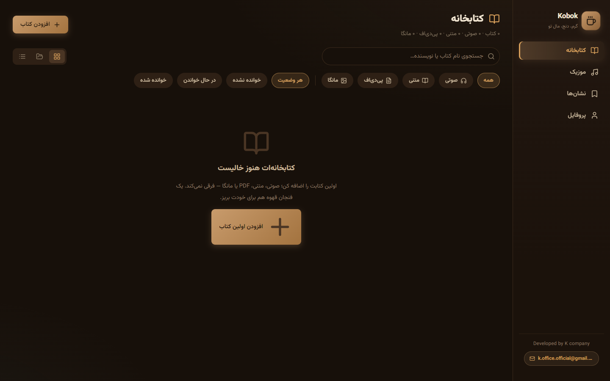

<div align="center">

# KOBOK | کوبوک

### Your Personal Library. All in One Place.
### کتابخانهٔ شخصی تو، همه‌چیز در یک‌جا

**Books · Audiobooks · PDF · Manga · Music**  
**کتاب، کتاب صوتی، PDF، مانگا و موسیقی**

[دانلود آخرین نسخه برای ویندوز](https://github.com/Kmahdak/Kobok/releases/latest) ·
[گزارش مشکل](https://github.com/Kmahdak/Kobok/issues) ·
[ارتباط با توسعه‌دهنده](mailto:k.office.official@gmail.com)


</div>

---

## فارسی

### کوبوک چیست؟

**کوبوک (Kobok)** یک کتابخانهٔ شخصی و کاملاً آفلاین برای ویندوز است که کتاب‌ها، کتاب‌های صوتی، فایل‌های PDF، مانگا و موسیقی را در یک محیط یکپارچه جمع می‌کند.

با کوبوک می‌توانی مجموعهٔ شخصی‌ات را مرتب کنی، کتاب بخوانی، به کتاب صوتی گوش بدهی، مانگا تماشا کنی و موسیقی پخش کنی؛ بدون نیاز به حساب کاربری یا اتصال اینترنت.

رابط کاربری برنامه فارسی و راست‌چین (RTL) است و اطلاعات برنامه به‌صورت محلی روی دستگاه خودت نگهداری می‌شوند.

### تصاویر برنامه

> تصاویر واقعی برنامه را با نام‌های زیر در مسیر `docs/screenshots/` قرار بده. تا پیش از افزودن تصاویر، این بخش صرفاً جایگاه آن‌هاست.

| کتابخانه | کتابخوان PDF |
|---|---|
|  |  |

| کتاب صوتی | مانگا و کمیک |
|---|---|
|  |  |

| کتابخوان EPUB | پروفایل و آمار |
|---|---|
|  |  |

### امکانات

#### 📚 کتابخانهٔ شخصی
- افزودن کتاب با عنوان، نویسنده، جلد و فایل
- تشخیص خودکار مجموعه و شمارهٔ جلد
- افزودن دسته‌ای چند کتاب با اطلاعات مشترک
- جست‌وجو و فیلتر بر اساس نوع و نویسنده
- نمایش کتاب‌ها به‌شکل شبکه‌ای یا فهرستی

#### 🎧 کتابخوان صوتی
- پخش‌کنندهٔ اختصاصی با نمایش زندهٔ روند پخش
- کنترل سرعت پخش و میان‌برهای صفحه‌کلید
- ادامهٔ پخش از آخرین موقعیت

#### 📖 کتابخوان EPUB و TXT
- پشتیبانی از فایل‌های EPUB و TXT
- اسکرول روان
- حفظ موقعیت مطالعه
- رابط گرم و مناسب مطالعه

#### 📄 کتابخوان PDF
- رندر فایل‌ها با موتور PDF.js
- پشتیبانی از فونت‌های فارسیِ تعبیه‌شده در PDF
- هایلایت، قلم، انتخاب و کپی متن
- اسکرین‌شات از محدودهٔ انتخاب‌شده
- حالت‌های اسکرول، تک‌صفحه و دوصفحهٔ کتابی
- ذره‌بین با قابلیت تنظیم بزرگ‌نمایی

#### 📕 مانگا و کمیک
- پشتیبانی از CBZ، CBR و RAR
- حالت‌های اسکرول، تک‌صفحه و دوصفحه
- تنظیم ترتیب خواندن راست‌به‌چپ یا چپ‌به‌راست
- ذره‌بین با اندازه و بزرگ‌نمایی قابل تنظیم
- حفظ صفحهٔ فعلی هنگام تغییر حالت نمایش
- پیشنهاد رفتن به جلد بعدی در صفحهٔ پایانی

#### 🔖 نشانک‌ها و یادداشت‌ها
- نشانک‌ها با امکان دسته‌بندی در پوشه‌ها
- پرش دقیق به صفحه، درصد مطالعه یا زمان پخش
- مشاهدهٔ هایلایت‌ها و زیرخط‌دارها خارج از محیط کتابخوان
- یادداشت چسبان با قابلیت جابه‌جایی، تنظیم شفافیت و رنگ
- یادداشت آزاد و عمومی

#### 🎵 موسیقی
- کتابخانهٔ موسیقی با گروه‌بندی
- پخش تصادفی
- پخش‌کنندهٔ کوچک در دسترس از داخل کتابخوان‌ها

#### 📊 پروفایل
- آمار مطالعه همراه با نمودار
- امکان انتخاب قالب تاریخ شمسی یا میلادی

### حریم خصوصی و نگهداری اطلاعات

کوبوک برای استفادهٔ محلی طراحی شده است:

- برای عملکرد عادی به اینترنت نیاز ندارد.
- اطلاعات و داده‌های کتابخانه روی دستگاه خودت نگهداری می‌شوند.
- کتابخانهٔ شخصی تو به سرویس ابری یا سرور خارجی ارسال نمی‌شود.
- برنامه برای استفادهٔ معمول به ساخت حساب کاربری نیاز ندارد.

**هشدار مهم دربارهٔ حذف برنامه:** با حذف (Uninstall) کوبوک، داده‌های برنامه و پایگاه‌دادهٔ محلی آن نیز پاک می‌شوند. در نسخهٔ فعلی، قابلیت پشتیبان‌گیری داخلی هنوز ارائه نشده است. بنابراین پیش از حذف برنامه، اطلاعات یا فایل‌های مهمت را در محل امن دیگری نگه دار. فایل‌های اصلی کتاب‌هایت را نیز جداگانه حفظ کن.

### دانلود و نصب

**نسخهٔ فعلی:** `v1.0.0`  
**سیستم‌عامل:** Windows 10 و Windows 11  
**نام فایل نصب:** `Kobok-Setup-1.0.0.exe`  
**حجم تقریبی:** ۲۰۰ مگابایت

1. وارد صفحهٔ [آخرین انتشارها (Releases)](https://github.com/Kmahdak/Kobok/releases/latest) شو.
2. فایل `Kobok-Setup-1.0.0.exe` را دانلود کن.
3. فایل نصب را اجرا و مراحل نصب را دنبال کن.
4. پس از نصب، کوبوک را اجرا و کتابخانهٔ شخصی‌ات را ایجاد کن.

اگر ویندوز دربارهٔ ناشناس بودن ناشر یا فایل نصب هشدار داد، پیش از اجرا مطمئن شو فایل را از صفحهٔ رسمی انتشار کوبوک دریافت کرده‌ای. این هشدار ممکن است در برنامه‌هایی که امضای دیجیتال معتبر ندارند نمایش داده شود.

راهنمای بیشتر: [راهنمای نصب](docs/INSTALLATION.md)

### نسخهٔ هدیه (Gift Edition)

کوبوک یک نسخهٔ جداگانه با عنوان **Gift Edition** نیز دارد. این نسخه با متغیر `VITE_GIFT=1` ساخته می‌شود و در اولین اجرا یک معرفی سینمایی تعاملی نمایش می‌دهد. این نسخه همچنین پروفایل تک‌کاربره با نام اختصاصی دارد.

دستورهای ساخت:

```bash
npm run dev:gift
npm run dist:gift
```

این نسخه از نسخهٔ اصلی جداست و خروجی نصب‌کنندهٔ مستقلی تولید می‌کند. برای جزئیات و دریافت فایل آن، صفحهٔ [Releases](https://github.com/Kmahdak/Kobok/releases) را بررسی کن.

### گزارش مشکل و پیشنهاد

اگر با مشکلی روبه‌رو شدی یا پیشنهادی برای بهتر شدن کوبوک داری:

- [گزارش مشکل یا پیشنهاد در GitHub](https://github.com/Kmahdak/Kobok/issues)
- ایمیل: [k.office.official@gmail.com](mailto:k.office.official@gmail.com)
- توییتر / X: [@k_mahdak](https://x.com/k_mahdak)

### توسعه و ساخت از سورس

کوبوک با فناوری‌های زیر ساخته شده است:

- Electron
- Vite 5
- React 18
- TypeScript (Strict)
- Dexie / IndexedDB
- PDF.js
- JSZip
- node-unrar-js
- Recharts
- فونت وزیرمتن (Vazirmatn)

#### پیش‌نیازها
- Node.js و npm
- Windows 10 یا Windows 11
- Git (پیشنهادی)

#### دریافت سورس و نصب وابستگی‌ها

```bash
git clone https://github.com/Kmahdak/Kobok.git
cd Kobok
npm install
```

#### اجرای محیط توسعه

```bash
npm run dev
npm start
```

#### ساخت نصب‌کنندهٔ ویندوز

```bash
npm run dist
```

خروجی ساخت، طبق تنظیمات پروژه، در پوشهٔ `dist` قرار می‌گیرد.

> نام دستورها و جزئیات ساخت بر اساس تنظیمات فعلی پروژه نوشته شده‌اند. برای اجرای موفق، فایل‌های سورس و وابستگی‌های لازم باید در مخزن موجود باشند.

### توسعه‌دهنده

**Developed by K Company**  
GitHub: [@Kmahdak](https://github.com/Kmahdak)  
X: [@k_mahdak](https://x.com/k_mahdak)  
Email: [k.office.official@gmail.com](mailto:k.office.official@gmail.com)

---

## English

### What is Kobok?

**Kobok** is an offline personal library for Windows that brings books, audiobooks, PDFs, manga, comics, and music together in one desktop application.

Organize your collection, read ebooks and PDFs, listen to audiobooks, browse manga, and play music — all in one place, without requiring an internet connection or an online account.

Kobok features a Persian, right-to-left interface and stores its application data locally on your device.

### Key Features

- **Personal Library:** Add and organize books with titles, authors, covers, series detection, search, and filters.
- **Audiobooks:** Dedicated player, playback speed controls, keyboard shortcuts, and resume playback.
- **EPUB & TXT Reader:** Smooth reading experience with saved reading position.
- **PDF Reader:** PDF.js rendering, embedded Persian font support, annotations, text selection, screenshots, multiple page layouts, and magnifier.
- **Manga & Comics:** CBZ, CBR, and RAR support, multiple reading layouts, reading direction controls, and magnifier.
- **Bookmarks & Notes:** Organized bookmarks, highlights, underlines, sticky notes, and general notes.
- **Music:** Organized music library, shuffle playback, and an in-reader mini player.
- **Profile:** Reading statistics, charts, and Jalali/Gregorian date formats.

### Privacy & Offline Use

Kobok is designed to work locally on your Windows device.

- No internet connection is required for normal use.
- Your library data is stored locally.
- Your personal library is not uploaded to an external server or cloud service.

**Important:** Uninstalling Kobok also deletes its local application data and database. Built-in backup functionality is not available in the current version. Keep separate copies of important files before uninstalling.

### Download

- **Current version:** `v1.0.0`
- **Supported systems:** Windows 10 and Windows 11
- **Installer:** `Kobok-Setup-1.0.0.exe`
- **Approximate size:** 200 MB

[Download the latest release](https://github.com/Kmahdak/Kobok/releases/latest)

### Gift Edition

Kobok also includes a separate Gift Edition, enabled with `VITE_GIFT=1`. It displays an interactive cinematic introduction on first launch and provides a personalized single-user profile.

```bash
npm run dev:gift
npm run dist:gift
```

### Development

Built with Electron, Vite 5, React 18, TypeScript, Dexie/IndexedDB, PDF.js, JSZip, node-unrar-js, Recharts, and Vazirmatn.

```bash
git clone https://github.com/Kmahdak/Kobok.git
cd Kobok
npm install
npm run dev
npm start
npm run dist
```

### Support & Contact

- GitHub: [@Kmahdak](https://github.com/Kmahdak)
- X: [@k_mahdak](https://x.com/k_mahdak)
- Email: [k.office.official@gmail.com](mailto:k.office.official@gmail.com)
- Issues: [GitHub Issues](https://github.com/Kmahdak/Kobok/issues)

**Developed by K Company**

</div>
